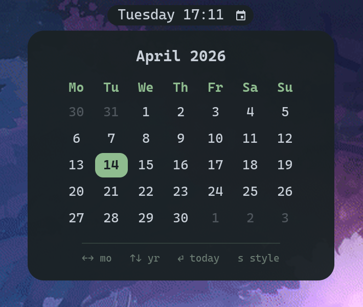

# Next To Do

A small, always-on-top todo panel for Wayland compositors such as
[Niri](https://github.com/YaLTeR/niri), written in Rust with GTK4 and
`gtk4-layer-shell`. It pairs with [waybar](https://github.com/Alexays/Waybar) by
printing today's unfinished item counts.



## Features

- Centred, rounded, always-on-top panel (layer-shell `overlay`)
- Order-bounded items (positioned after a predecessor) and time-bounded items
  (positioned by a deadline)
- TUI-style single-key controls, every binding configurable
- Mouse and keyboard cover the same actions
- `next_to_do waybar` prints `order-bounded:time-bounded` for today
- State and configuration under `~/.config/next_to_do/`

## Requirements

- A Wayland compositor with layer-shell support (Niri, Hyprland, Sway, ...)
- GTK4 and gtk4-layer-shell development packages:
  - Arch: `gtk4 gtk4-layer-shell`
  - Debian/Ubuntu: `libgtk-4-dev libgtk4-layer-shell-dev`
- Rust with edition 2024 support (1.85+)

## Build and install

```sh
cargo build --release
install -Dm755 target/release/next_to_do ~/.local/bin/next_to_do
```

## Usage

```sh
next_to_do          # open the panel
next_to_do waybar   # print "order-bounded:time-bounded" for today
next_to_do help     # usage and file locations
```

The panel is created once and kept alive; running `next_to_do` again toggles it.
`Escape` hides it, `q` quits.

### Keys

| Key        | Action                                         |
| ---------- | ---------------------------------------------- |
| `j` / `↓`  | select next item                               |
| `k` / `↑`  | select previous item                           |
| `space`    | toggle selected item done / not done           |
| `a`        | add an order-bounded item                      |
| `e`        | rename the selected item                       |
| `t`        | set the deadline (turns it into time-bounded)  |
| `o`        | drop the deadline (back to order-bounded)      |
| `d`        | delete the selected item                       |
| `Ctrl+j`   | move the selected item down                    |
| `Ctrl+k`   | move the selected item up                      |
| `Ctrl+r`   | reload `items.json` from disk                  |
| `Escape`   | hide the panel                                 |
| `q`        | quit                                           |

Clicking a row selects it, clicking its `○` marks it done. Deadlines are typed as
`YYYY-MM-DD HH:MM`, `YYYY-MM-DD HH:MM:SS` or `YYYY-MM-DD` (meaning 23:59).

All of these keys can be changed in `~/.config/next_to_do/config.json`, e.g.

```json
{
  "keys": {
    "move_down": "j,Down,n",
    "toggle_done": "space,Enter",
    "quit": "q,Ctrl+q"
  }
}
```

### Waybar

```jsonc
"custom/nexttodo": {
    "exec": "next_to_do waybar",
    "interval": 30,
    "format": " {}",
    "tooltip": false
}
```

### Niri

```kdl
binds {
    Mod+Shift+T { spawn "next_to_do"; }
}
```

## Data

- `~/.config/next_to_do/items.json` — the items
- `~/.config/next_to_do/config.json` — the key bindings

See [docs/ARCHITECTURE.md](docs/ARCHITECTURE.md) for the data model, the ordering
rules and the waybar output.
