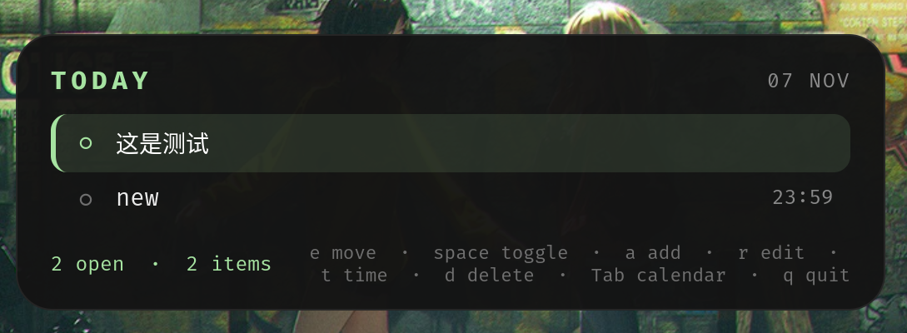

# Next To Do

[English](README.md) | 中文文档

一个运行在 Wayland 桌面环境（如 [Niri](https://github.com/YaLTeR/niri)）上的小型悬浮代办事项面板，
使用 Rust、GTK4 与 `gtk4-layer-shell` 编写，并可为
[waybar](https://github.com/Alexays/Waybar) 提供今日未完成事项的计数。
应用风格参考 [waycal](https://github.com/ForrestKnight/waycal)。



## 特性

- 居中、圆角、始终置顶的面板（layer-shell `overlay`）
- 由顺序框定的 `order-bounded` 事项与由时间框定的 `time-bounded` 事项
- 内置月历，可查看任意一天的事项；仍有未完成事项的日期下方带圆点标记
- TUI 风格的单键操作，所有按键均可配置
- 鼠标操作与键盘操作一一对应
- `next_to_do waybar` 输出今日的 `order-bounded:time-bounded` 计数
- 数据与配置存放于 `~/.config/next_to_do/`

## 依赖

- 支持 layer-shell 的 Wayland 合成器（Niri、Hyprland、Sway 等）
- GTK4 与 gtk4-layer-shell 开发包：
  - Arch：`gtk4 gtk4-layer-shell`
  - Debian/Ubuntu：`libgtk-4-dev libgtk4-layer-shell-dev`
- 支持 edition 2024 的 Rust（1.85+）

## 构建与安装

```sh
cargo build --release
install -Dm755 target/release/next_to_do ~/.local/bin/next_to_do
```

## 使用

```sh
next_to_do          # 打开面板
next_to_do waybar   # 输出今日的 "order-bounded:time-bounded"
next_to_do help     # 查看用法与文件位置
```

面板只创建一次并常驻；再次运行 `next_to_do` 会切换其显示状态。
`q` 退出程序；`Escape` 从月历返回列表（在列表中则隐藏面板）。

### 按键

面板分为上下两块：上面是月历，下面是事项列表。月历默认隐藏，按 `Tab` 才展开并把焦点交给它（显示绿色描边），
再按 `Tab`/`Enter`/`Escape` 收起并回到列表。两块各自只响应自己的按键，
所以 `j`/`k` 在列表里是「下一项/上一项」，在月历里是「下一周/上一周」，互不冲突。

| 按键       | 功能                                    |
| ---------- | --------------------------------------- |
| `j` / `↓`  | 选中下一项                              |
| `k` / `↑`  | 选中上一项                              |
| `space`    | 切换选中项的完成状态                    |
| `a`        | 新增 `order-bounded` 事项               |
| `e`        | 重命名选中项                            |
| `t`        | 把选中项设为月历当前日的 `time-bounded` |
| `o`        | 取消 deadline（转回 `order-bounded`）   |
| `d`        | 删除选中项                              |
| `Ctrl+j`   | 将选中项下移                            |
| `Ctrl+k`   | 将选中项上移                            |
| `Ctrl+r`   | 从磁盘重新载入 `items.json`             |
| `Tab`      | 切换到月历                              |
| `Escape`   | 隐藏面板                                |
| `q`        | 退出                                    |

点击某一行可选中它，点击行首的 `○` 可标记完成。

### 月历

按 `Tab` 展开月历，它始终显示列表所对应的那一天，因此切换到其它日期的方式就是移动月历中的高亮日。
仍有未完成 `time-bounded` 事项的日期下方会显示一个圆点。

| 按键              | 功能                                 |
| ----------------- | ------------------------------------ |
| `h` / `←`         | 前一天                               |
| `l` / `→`         | 后一天                               |
| `k` / `↑`         | 上一周                               |
| `j` / `↓`         | 下一周                               |
| `[` / `Page_Up`   | 上一个月（日期存在时保持同一天）     |
| `]` / `Page_Down` | 下一个月                             |
| `t`               | 回到今天                             |
| `Enter` / `Tab`   | 收起月历，回到列表                   |
| `Escape`          | 收起月历，回到列表                   |

在事项上按 `t` 时，日期取自月历当前高亮的那一天：此时只需填写时间（`HH:MM`），
月历仍然可以继续移动，确认前还能改日期。日历中的日期也可以直接点击。

以上按键都可以在 `~/.config/next_to_do/config.json` 中修改，例如：

```json
{
  "keys": {
    "move_down": "j,Down,n",
    "toggle_done": "space,Enter",
    "quit": "q,Ctrl+q",
    "cal_next_month": "],Page_Down,n",
    "cal_confirm": "Return,Enter"
  }
}
```

### Waybar

```jsonc
"custom/nexttodo": {
    "exec": "next_to_do waybar",
    "interval": 30,
    "format": " {}",
    "tooltip": false
}
```

### Niri

```kdl
binds {
    Mod+Shift+T { spawn "next_to_do"; }
}
```

## 数据文件

- `~/.config/next_to_do/items.json` — 事项数据
- `~/.config/next_to_do/config.json` — 按键配置

数据模型、排序规则与 waybar 接口的说明见 [docs/ARCHITECTURE.md](docs/ARCHITECTURE.md)。
